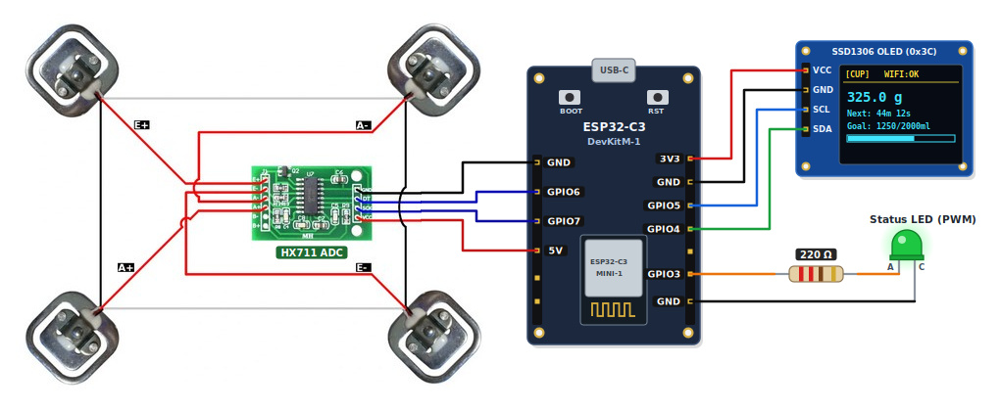
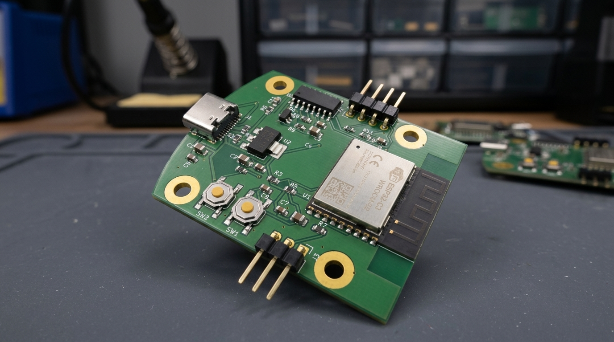

# Smart Cup Stand (ESP32-C3 & ESP32)

Firmware, Wokwi hardware simulations, and a custom 2-layer KiCad 10 PCB for an ESP32-C3 / ESP32 hydration tracking coaster. Instead of Time-of-Flight (ToF) distance sensors that only detect whether a bottle was picked up, this system uses a 4-cell Wheatstone bridge load cell and HX711 24-bit ADC to measure beverage mass deltas. It separates real drinks from fidget lifts and refills while driving an SSD1306 OLED UI, PWM or WS2812 NeoPixel ring LED alerts, UART JSON telemetry, and `ntfy.sh` HTTP push notifications.



## Architecture

The firmware separates hardware-independent hydration state machines from ESP32 peripherals and network services:

- **Core Domain (`lib/coaster_domain/`)**: Pure C++17 state machine (`CupState`, `AlertState`) with zero `<Arduino.h>` dependencies for native host unit testing.
- **Hardware Abstraction Layer (`src/hal/`)**:
  - `WeightSensor`: Non-blocking HX711 driver (`0.42` counts/g default calibration for Wokwi 5 kg load cell).
  - `DisplayOled`: SSD1306 128x64 I2C display renderer (`0x3C`, 400 kHz Fast I2C) showing state badge, Wi-Fi status, live weight, countdown timer, and daily goal progress bar.
  - `StatusLed`: Non-blocking 5 kHz, 8-bit LEDC PWM sinusoidal breathing and celebration flash engine.
- **Telemetry & CLI (`src/telemetry/`)**: Single-line JSON event/heartbeat emitter and non-blocking UART0 command parser using fixed static buffers (zero heap allocation in steady state).
- **Network Push (`src/net/`)**: Non-blocking Wi-Fi station manager with exponential backoff and bounded FIFO queue (`maxlen=3`, 2000 ms rate limit) dispatching HTTP POST notifications to `ntfy.sh`.
- **Cooperative Scheduler (`src/main.cpp`)**: Rollover-safe multi-rate loop running UART RX polling (continuous), LED PWM (50 Hz), weight sampling + domain ticks (20 Hz), network dispatch (20 Hz), OLED rendering (10 Hz), and telemetry heartbeats (0.2 Hz).

```
├── platformio.ini                   # Build & test config (esp32-c3-devkitm-1, esp32dev, native)
├── diagram.json                     # Default Wokwi schematic (OLED + PWM LED + HX711)
├── diagram_led_ring.json            # Wokwi schematic with 16-pixel WS2812 LED ring
├── diagram_round_coaster.json       # Wokwi circular coaster layout (16 radial NeoPixels)
├── wokwi.toml                       # Wokwi firmware binary linkage
├── schematic.jpeg                   # Default hardware wiring diagram
├── schematic_led_ring.jpeg          # 16-LED NeoPixel ring wiring diagram
├── schematic_round_coaster.jpeg     # Circular coaster discrete NeoPixel wiring diagram
├── docs/
│   └── app-screens/                 # Companion mobile app UI prototypes (dashboard, alerts, analytics, config)
├── hardware/
│   └── smart_cup_stand_pcb/         # KiCad 10 D-shaped PCB project & JLCPCB manufacturing package
│       ├── smart_cup_stand_pcb.kicad_pro
│       ├── smart_cup_stand_pcb.kicad_sch
│       ├── smart_cup_stand_pcb.kicad_pcb
│       └── manufacturing/           # Gerbers, drill, BOM, CPL, PDFs, DRC/DFM reports, and 3D renders
├── include/
│   ├── pins_config.h                # Multi-target ESP32-C3 & ESP32 pinout + strapping/flash guards
│   ├── config.h                     # Wi-Fi, ntfy.sh, and domain defaults
│   └── secrets.example.h            # Template for local include/secrets.h (gitignored)
├── lib/
│   └── coaster_domain/              # Pure C++ hydration domain state machine
├── src/
│   ├── main.cpp                     # Multi-rate cooperative scheduler
│   ├── hal/                         # HX711, SSD1306 OLED, and LEDC PWM drivers
│   ├── telemetry/                   # UART CLI & single-line JSON telemetry
│   └── net/                         # Wi-Fi manager & ntfy.sh HTTP client
└── test/
    ├── test_coaster_domain/         # Native Unity unit tests (domain logic)
    ├── test_pins_config/            # Native Unity unit tests (ESP32-C3 & ESP32 pin safety invariants)
    └── e2e/                         # 5-tier opaque-box E2E & adversarial test suite
```

## Hydration State Machine & Thresholds

| Parameter | Normal Mode | Demo Mode (`DEMO ON`) | Behavior |
| :--- | :--- | :--- | :--- |
| **Stability Filter** | 1.5 s window, span ≤ 3.0 g | 1.5 s window, span ≤ 3.0 g | Sliding window (`≥ 3` samples); reports arithmetic mean once settled |
| **Empty Auto-Tare** | `±5.0 g` for 5.0 s | `±5.0 g` for 1.0 s | Automatically zeroes load cell drift (`≥ 0.05 g`) while in `EMPTY` |
| **Cup Presence** | `> 30.0 g` (stable) | `> 30.0 g` (stable) | Transitions `EMPTY` → `STABILIZING` → `CUP_PRESENT` and locks baseline |
| **Cup Lift** | `< 20.0 g` | `< 20.0 g` | Transitions `CUP_PRESENT` → `CUP_LIFTED` (hysteresis prevents chatter) |
| **Valid Drink** | `Δ ≤ -15.0 g` | `Δ ≤ -15.0 g` | Logs `baseline - returned` (g ≈ ml) to daily intake, clears alerts, resets timer |
| **Lift Without Drink** | `-15.0 g < Δ < +30.0 g` | `-15.0 g < Δ < +30.0 g` | Updates baseline to track condensation/drift without logging intake or resetting timer |
| **Refill Detection** | `Δ ≥ +30.0 g` | `Δ ≥ +30.0 g` | Updates baseline to new heavier weight; does not log intake or reset timer |
| **Primary Reminder** | 45 minutes | 45 seconds | Enters `ALERT_DUE`, pulses status LED, shows `[ALERT]`, dispatches push notification |
| **Repeat Reminder** | Every 5 minutes | Every 5 seconds | Enters `ALERT_REPEAT`, re-notifies every interval until a valid drink is logged |
| **Daily Goal** | 2000 ml (default) | 2000 ml (default) | Configurable `100..10000 ml`; triggers celebration LED & push notification at 100% |

## Hardware Pinout

The firmware supports two board targets configured in `platformio.ini` and `include/pins_config.h`:

1. **`esp32-c3-devkitm-1` (Default / Wokwi Simulation)**: Avoids ESP32-C3 strapping pins (`GPIO 2`, `GPIO 8`, `GPIO 9`) so external loads cannot hold `GPIO 9` low during reset or conflict with the onboard WS2812 RGB LED on `GPIO 8`.
2. **`esp32dev` (`BOARD_ESP32_CLASSIC` / `ESP32-D0WD-V3`)**: Avoids integrated SPI flash pins (`GPIO 6..11`) and strapping pins (`GPIO 0`, `GPIO 2`, `GPIO 12`, `GPIO 15`).

| Peripheral | Signal | ESP32-C3 Pin (`esp32-c3-devkitm-1`) | Classic ESP32 Pin (`esp32dev`) | Notes |
| :--- | :--- | :--- | :--- | :--- |
| **HX711 Load Cell Amp** | `DT` (DOUT) | `GPIO 6` (J3-9) | `GPIO 18` | 24-bit ADC serial data input |
| **HX711 Load Cell Amp** | `SCK` (PD_SCK) | `GPIO 7` (J3-8) | `GPIO 19` | 24-bit ADC serial clock output |
| **SSD1306 OLED (128x64)** | `SDA` | `GPIO 4` (J3-11) | `GPIO 21` | I2C Data (`0x3C`) |
| **SSD1306 OLED (128x64)** | `SCL` | `GPIO 5` (J3-10) | `GPIO 22` | I2C Clock (400 kHz Fast Mode) |
| **Status Alert LED / Ring** | `PWM` / `DIN` | `GPIO 3` (J1-5) | `GPIO 4` | Via series resistor to status LED or WS2812 `DIN` |
| **UART0 Console** | `TX` / `RX` | `GPIO 21` / `GPIO 20` | `GPIO 1` / `GPIO 3` | 115200 8N1 interactive CLI & JSON telemetry stream |

### 4-Cell Load Cell Wheatstone Bridge Wiring

Four 3-wire (50 kg) half-bridge load cells form a full Wheatstone bridge into the HX711:
- **Top-Left (`E+`) & Bottom-Right (`E-`)**: Center signal wires connect to `E+` and `E-` excitation pins.
- **Bottom-Left (`A+`) & Top-Right (`A-`)**: Center signal wires connect to `A+` and `A-` differential sense pins.
- **Outer Loop**: Outer red/black half-bridge leads pair with adjacent corners as shown in `schematic.jpeg` so compression on all four feet sums constructively.

### Alternative Wokwi Topologies

In addition to `diagram.json`, the repository provides two NeoPixel ring simulation layouts:

| Layout | Wokwi Diagram | Schematic | Description |
| :--- | :--- | :--- | :--- |
| **OLED + Status LED** | `diagram.json` | `schematic.jpeg` | SSD1306 128x64 I2C OLED + PWM status LED + HX711 |
| **16-LED Ring Module** | `diagram_led_ring.json` | `schematic_led_ring.jpeg` | `wokwi-led-ring` (16 pixels on `GPIO 3` via 330 Ω resistor) + HX711 |
| **Circular Coaster** | `diagram_round_coaster.json` | `schematic_round_coaster.jpeg` | 16 discrete radially-arranged WS2812 pixels (`led0..led15`) + HX711 |

## Custom PCB & JLCPCB Manufacturing (`hardware/smart_cup_stand_pcb/`)

`hardware/smart_cup_stand_pcb/` holds a 2-layer D-shaped ~50 mm x 40 mm KiCad 10 PCB with 0 ERC violations, 0 DRC violations, and a complete JLCPCB SMT assembly package.

- **Board outline and mounting.** An R = 48 mm curved left USB-C edge fits inside a 100 mm round coaster with a 2 mm enclosure wall. Left M3 mounting holes `H1` and `H4` sit at `x = 108.50 mm`, while right M3 mounting holes `H2` and `H3` sit at `x = 139.50 mm`, `y = 83.50` and `116.50 mm`, clearing `U1`'s antenna courtyard.
- **USB-C power and regulation.** USB-C receptacle `J1`, HRO `TYPE-C-31-M-12`, LCSC `C165948`, protrudes 1.05 mm past the R = 48 mm arc apex so USB-C cable plugs clear the curved shell. Two 5.1 kΩ CC1 and CC2 pulldowns `R1` and `R2` feed an `AMS1117-3.3` LDO `U2`, LCSC `C6186`, and a 10 uF and 100 nF decoupling network `C1..C11`.
- **Orthogonal Wi-Fi edge and perimeter headers.** `ESP32-C3-WROOM-02` module `U1`, LCSC `C2934560`, sits flush with the straight right PCB edge at `x = 150.00 mm` with a 2-layer copper keepout across `x = 144.00..150.00 mm` and `y = 86.00..114.00 mm`. Planar right-angle 2.54 mm headers exit orthogonally into the coaster cavity. North-facing 4-pin Wheatstone bridge header `J2`, XFCN `PZ254R-11-04P`, LCSC `C492412`, carries silkscreen labels `E+`, `E-`, `A-`, `A+` at `x = 126.20, y = 83.85 mm` with 27.8 mm radial wall clearance. South-facing 3-pin WS2812 LED ring header `J3`, XFCN `PZ254R-11-03P`, LCSC `C492411`, carries silkscreen labels `5V`, `DIN`, `GND` at `x = 133.50, y = 116.15 mm` with 31.0 mm radial wall clearance.
- **Analog front-end and buttons.** Top-strip 24-bit ADC `U3`, `HX711` SOIC-16, LCSC `C43656`, pairs with an `SS8550` PNP high-side AVDD transistor `Q1`, LCSC `C2145`, a 20 kΩ and 8.2 kΩ regulator divider `R8` and `R9`, and a 100 Ω differential input filter `R10` and `R11`. Power rails run at `0.50 mm` for `+5V` and `0.40 mm` for `+3V3` and load-cell excitation `LC_E+`. Tactile `TL3342` Reset `SW1` and Boot `SW2` buttons sit along the bottom strip.
- **Manufacturing outputs.** `hardware/smart_cup_stand_pcb/manufacturing/` includes the fabrication and SMT assembly files:
  - `gerbers/` holds 2-layer Gerber X2 files `.gbr` and `.gbrjob` plus the Excellon drill file `smart_cup_stand_pcb.drl`.
  - `bom.csv`, `jlcpcb_bom.csv`, and `cpl.csv` list bill-of-materials entries with LCSC part numbers and pick-and-place centroid coordinates.
  - `schematic.pdf` and `pcb.pdf` provide printable schematic and PCB artwork plots.
  - `erc_report.json`, `drc_report.json`, `dfm_profile_check.json`, `pcb_quality_gate.json`, and `schematic_quality_gate.json` record automated ERC, DRC, and JLCPCB DFM signoff results.
  - `renders/` contains raytraced 3D CAD views `pcb_cad_3d_top.png`, `pcb_cad_3d_bottom.png`, and `pcb_cad_3d_angle.png` alongside photorealistic board renders `pcb_reallife_top.jpg` and `pcb_reallife_angle.jpg`.



## Companion App UI Prototypes (`docs/app-screens/`)

Reference mobile UI screens for the companion hydration app and `ntfy.sh` notification workflow live in `docs/app-screens/`:
- `01_dashboard.png`: Live Smart Coaster hydration progress and cup weight dashboard.
- `02_notifications.png`: Lock-screen push notification prototype (`ntfy.sh` reminder & goal alerts).
- `03_charts_analytics.png`: Daily/weekly hydration intake and sip-size analytics.
- `04_configuration.png`: Coaster Wi-Fi, `ntfy.sh` topic, tare, and reminder interval settings.

## Quick Start

### 1. Configure Wi-Fi & `ntfy.sh` Credentials (Optional)

For Wokwi simulation, the firmware defaults to the open `Wokwi-GUEST` network and public `http://ntfy.sh/smart-cup-stand` topic. For physical hardware deployment, copy the secrets template:

```bash
cp include/secrets.example.h include/secrets.h
```

Edit `include/secrets.h` (which is gitignored and automatically included by `include/config.h` via `__has_include("secrets.h")`):

```cpp
#define WIFI_SSID           "your-wifi-ssid"
#define WIFI_PASSWORD       "your-wifi-password"
#define NTFY_SERVER_URL     "http://ntfy.sh"
#define NTFY_DEFAULT_TOPIC  "smart-coaster-your-private-topic"
```

### 2. Build Firmware with PlatformIO

```bash
# Compile ESP32-C3 firmware (.pio/build/esp32-c3-devkitm-1/firmware.bin)
pio run -e esp32-c3-devkitm-1

# Or compile Classic ESP32 firmware (.pio/build/esp32dev/firmware.bin)
pio run -e esp32dev

# Flash to physical board and open serial monitor
pio run -e esp32-c3-devkitm-1 -t upload -t monitor
```

### 3. Run in Wokwi Simulator

1. Install the **Wokwi Simulator** extension for VS Code (or Wokwi CLI).
2. Build the firmware first (`pio run -e esp32-c3-devkitm-1`).
3. Open `diagram.json` (or `diagram_led_ring.json` / `diagram_round_coaster.json`) and start the simulation. Use the HX711 weight slider to simulate placing a cup (`> 30 g`), lifting (`< 20 g`), drinking (`≥ 15 g` lighter), and refilling (`≥ 30 g` heavier).

## UART CLI & Telemetry Protocol

Connect to UART0 at `115200` baud (`LF`, `CR`, or `CRLF` line endings).

### Interactive Commands

| Command | Description | Example Response |
| :--- | :--- | :--- |
| `DEMO ON` | Enable 60x time acceleration (45s reminder, 5s repeat, 1s tare) | `{"status":"OK","command":"DEMO ON","demo_mode":true}` |
| `DEMO OFF` | Restore normal production timers (45m reminder, 5m repeat, 5s tare) | `{"status":"OK","command":"DEMO OFF","demo_mode":false}` |
| `TARE` | Zero the scale at the current raw weight and clear baseline | `{"status":"OK","command":"TARE","tare_offset_g":12.4}` |
| `RESET` | Reset daily consumed intake, drink count, and active alerts | `{"status":"OK","command":"RESET","consumed_ml":0.0}` |
| `GOAL <ml>` | Set daily hydration target (`100` to `10000` ml) | `{"status":"OK","command":"GOAL","daily_goal_ml":2500.0,"progress_pct":10.0}` |
| `STATUS` | Emit full snapshot of current coaster state and metrics | `{"status":"OK","command":"STATUS","cup_state":"CUP_PRESENT",...}` |

### Single-Line JSON Telemetry Stream

Telemetry packets are emitted on every domain event (`CUP_PLACED`, `CUP_LIFTED`, `DRINK_LOGGED`, `LIFT_NO_DRINK`, `REFILL_DETECTED`, `REMINDER_ALERT`, `REPEAT_ALERT`, `AUTO_TARE_APPLIED`, `GOAL_REACHED`) and periodically every `5000 ms` (`HEARTBEAT`):

```json
{"event":"DRINK_LOGGED","time_ms":42500,"net_weight_g":280.0,"cup_state":"CUP_PRESENT","alert_state":"COUNTING","is_stable":true,"consumed_ml":120.0,"daily_goal_ml":2000.0,"intake_pct":6.0,"remind_countdown_s":2700,"demo_mode":false,"state":"CUP_PRESENT","weight_g":280.0,"goal_ml":2000.0,"countdown_s":2700,"stable":true,"demo":false}
```

## Testing

The repository includes native C++ unit tests and a 5-tier opaque-box End-to-End (E2E) verification suite.

```bash
# 1. Run C++ native unit tests (domain state machine + pin safety invariants)
pio test -e native

# 2. Run the full 5-tier Python E2E test suite (172 tests across Tiers 1-5)
python3 test/e2e/run_e2e_tests.py

# Or run via pytest
python3 -m pytest test/e2e -v
```
